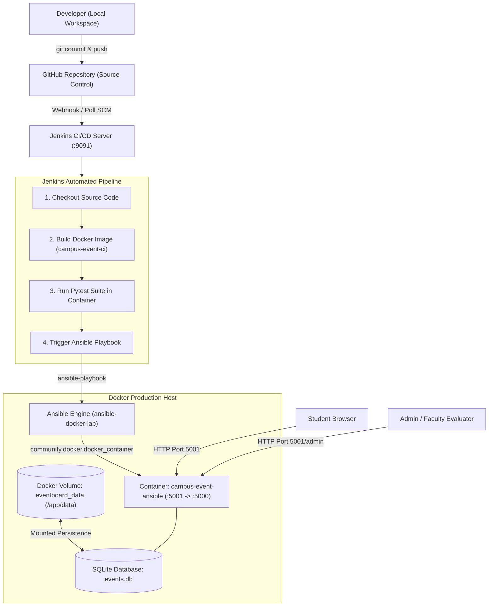

# 🎓 Campus Event Board — DevOps Laboratory Project

[](#)
[](#)
[](#)
[](#)
[](#)

> **Course**: 23IT723 – DevOps Laboratory  
> **Institution**: Coimbatore Institute of Technology (Autonomous Institution Affiliated to Anna University)  
> **Project Title**: CAMPUS EVENT BOARD  
> **Academic Year**: 2025–2026 | Semester VII  

---

## 📌 Project Overview

The **Campus Event Board** is an end-to-end web platform designed to streamline event discovery, registrations, and administrative monitoring across university departments. It eliminates manual physical notice boards and paper sign-ups with a reactive web portal, persistent attendee record keeping, and full automated DevOps CI/CD pipeline lifecycle management.

### Key Features
- **Student Event Discovery**: Interactive browsing with real-time category filtering (Hackathons, Workshops, Cultural, Technical, Sports, Seminars).
- **Live Search & Capacity Tracking**: Instantly search events with live visual capacity progress indicators.
- **One-Click RSVP & Digital Pass**: Generates unique cryptographic ticket IDs (`CIT-EVT-XXXXXX`) with print/save capabilities.
- **Admin Management Console**: Dedicated portal (`/admin`) for event publishing, seat quota modifications, and CSV exports of attendee rosters.
- **DevOps Toolchain**: Fully automated Git $\rightarrow$ Jenkins $\rightarrow$ Docker $\rightarrow$ Pytest $\rightarrow$ Ansible $\rightarrow$ Persistent SQLite Volume pipeline.

---

## 🏗️ System Architecture



---

## 🧰 Technology Stack

| Technology | Version | Purpose in Project |
| :--- | :--- | :--- |
| **HTML5 / CSS3** | Modern Standards | Responsive web layout, dark theme, glassmorphic cards |
| **JavaScript** | ES6+ | Real-time filtering, modal handling, local pass storage |
| **Font Awesome** | 6.5.1 | Standardized iconography across navigation and actions |
| **Python** | 3.11 / 3.14 | Backend programming language |
| **Flask** | 3.1.x | Lightweight backend web & REST API framework |
| **SQLite** | 3.x | Lightweight embedded relational database |
| **Git / GitHub** | 2.x | Source code version control & remote collaboration |
| **Jenkins** | 2.541.x | CI/CD automation server orchestrating build, test & deploy |
| **Docker** | 28.x | Application containerization & portable packaging |
| **Pytest** | 8.x / 9.x | Automated functional and endpoint test verification |
| **Ansible** | 2.10+ | Configuration management & automated container orchestration |
| **Docker Volume** | `eventboard_data` | Persistent database storage surviving container rebuilds |

---

## ⚡ Quick Start & Execution Guide

### 1. Local Development Execution (without Docker)
```bash
# Clone or navigate to the directory
cd campus-event-board

# Create virtual environment & activate
python3 -m venv .venv
source .venv/bin/activate

# Install requirements
pip install -r requirements.txt

# Run automated tests
pytest test_app.py -v

# Run the Flask application
# Note: On macOS, port 5000 is often reserved by AirPlay/ControlCenter; use PORT=5001:
PORT=5001 python app.py
```
Access the application locally at:
- **Public Portal**: [http://localhost:5001](http://localhost:5001)
- **Admin Dashboard**: [http://localhost:5001/admin](http://localhost:5001/admin)
- **Health Check**: [http://localhost:5001/health](http://localhost:5001/health)

---

### 2. SQLite Terminal Database Inspection

To query and inspect the persistent SQLite database directly from your terminal:

```bash
# Open SQLite interactive CLI
sqlite3 data/events.db
```

Useful commands inside the `sqlite>` prompt:
```sql
-- Format as readable grid table
.mode table
.headers on

-- View all database tables
.tables

-- View schema definitions
.schema events
.schema registrations

-- View all events
SELECT id, title, category, registered_count, capacity, status FROM events;

-- View attendee registrations
SELECT ticket_code, student_name, roll_no, department, email FROM registrations;

-- Exit
.quit
```

Quick terminal one-liner:
```bash
sqlite3 -header -column data/events.db "SELECT id, title, category, registered_count, capacity, status FROM events;"
```

---

### 3. Docker Containerization Workflow

#### Step A: Build the Docker Image
```bash
docker build -t campus-event-ci .
```

#### Step B: View and Inspect Docker Image
```bash
# List local images
docker images

# Inspect image details and layer metadata
docker inspect campus-event-ci
docker history campus-event-ci
```

#### Step C: Run Automated Tests Inside Docker Container
```bash
docker run --rm campus-event-ci python -m pytest test_app.py -v
```

#### Step D: Create Docker Volume for Persistent Data
```bash
docker volume create eventboard_data
docker volume ls
docker volume inspect eventboard_data
```

#### Step E: Run Container with Volume Persistence
```bash
docker run -d \
  --name campus-event-ansible \
  --restart unless-stopped \
  -p 5001:5000 \
  -v eventboard_data:/app/data \
  campus-event-ci
```

Verify running container:
```bash
docker ps
```
Access application at: [http://localhost:5001](http://localhost:5001)

---

### 4. Jenkins CI/CD Pipeline Setup & Execution

#### Step A: Spin Up Local Jenkins with Docker Socket Mount
```bash
docker run -d --name local-jenkins \
  --restart unless-stopped \
  -p 9091:8080 -p 50000:50000 \
  -v jenkins_home:/var/jenkins_home \
  -v /var/run/docker.sock:/var/run/docker.sock \
  jenkins/jenkins:lts
```

> **Docker-in-Jenkins Note**: Ensure the Docker CLI is installed in the container and permissions are granted on `/var/run/docker.sock`:
> ```bash
> docker exec -u 0 local-jenkins chmod 666 /var/run/docker.sock
> ```

#### Step B: Access Jenkins UI
1. Navigate to: **[http://localhost:9091](http://localhost:9091)**
2. Retrieve initial admin password:
   ```bash
   docker exec local-jenkins cat /var/jenkins_home/secrets/initialAdminPassword
   ```

#### Step C: Configure Pipeline Job
1. Click **New Item** $\rightarrow$ Enter `campus board` $\rightarrow$ Select **Pipeline** $\rightarrow$ Click **OK**.
2. Under the **Pipeline** configuration section:
   - **Definition**: `Pipeline script from SCM`
   - **SCM**: `Git`
   - **Repository URL**: `https://github.com/AKIILESH/campus-event-board.git`
   - **Branch Specifier**: `*/main`
   - **Script Path**: `Jenkinsfile`
3. Click **Save**.

#### Step D: Trigger Pipeline Build
Click **Build Now** to execute all 5 automated stages defined in [`Jenkinsfile`](Jenkinsfile):
```
[1. Checkout SCM] ➔ [2. Build Docker Image] ➔ [3. Run Pytest Tests] ➔ [4. Deploy with Ansible] ➔ [5. Verify Health]
```
View console outputs and test logs by clicking the build number $\rightarrow$ **Console Output**.

---

### 5. Automated Ansible Deployment

Run the Ansible playbook directly or inside your designated Ansible control container:
```bash
# Direct Ansible execution
ansible-playbook -i ansible/inventory.ini ansible/docker-deploy.yml

# Or inside the lab's ansible container (as demonstrated in report)
docker exec ansible-docker-lab ansible-playbook -i /inventory.ini /docker-deploy.yml
```

---

### 6. Container Database Verification Commands

Execute SQLite commands directly inside the running container:
```bash
# 1. View all database tables
docker exec campus-event-ansible python -c "import sqlite3; c=sqlite3.connect('/app/data/events.db'); print(c.execute(\"SELECT name FROM sqlite_master WHERE type='table'\").fetchall()); c.close()"

# 2. View all registered events
docker exec campus-event-ansible python -c "import sqlite3; c=sqlite3.connect('/app/data/events.db'); [print(row) for row in c.execute('SELECT id, title, registered_count, capacity, status FROM events')]; c.close()"

# 3. View student attendee registrations
docker exec campus-event-ansible python -c "import sqlite3; c=sqlite3.connect('/app/data/events.db'); [print(row) for row in c.execute('SELECT ticket_code, student_name, roll_no, event_id FROM registrations')]; c.close()"
```

---

## 🧪 Automated Testing Verification

The test suite in `test_app.py` asserts:
1. `test_health_check`: Validates HTTP 200 response and JSON status output.
2. `test_home_page_status`: Confirms landing page template renders without errors.
3. `test_get_events_api`: Asserts REST API returns properly formatted JSON event objects.
4. `test_event_registration_workflow`: Registers a student, verifies unique ticket code generation, validates count incrementation, and rejects duplicate roll number registrations with HTTP 409.
5. `test_admin_stats_and_endpoints`: Validates administrative metric calculations.

---

## 📋 Evaluation Scheme Alignment

| S.No | Evaluation Component | Target Marks | Realization in this Project |
| :---: | :--- | :---: | :--- |
| **1** | Problem Definition & Project Planning | 10 | Solves campus event tracking, requirements, scope, architecture |
| **2** | Git Repository & Version Control | 15 | Structured Git tree, descriptive commits, `.gitignore`, clear README |
| **3** | Branching, Merging & Collaboration | 10 | Feature branch workflow (`feature/ui`, `feature/api`, `feature/devops`) |
| **4** | Application Development & Build | 15 | Robust Flask application, SQLite persistence, modern dark UI |
| **5** | Jenkins Continuous Integration | 15 | Multi-stage declarative `Jenkinsfile` (Build $\rightarrow$ Test $\rightarrow$ Deploy) |
| **6** | Docker / Containerization | 10 | Optimized multi-layer `Dockerfile`, container runs on port 5001 |
| **7** | Automation / Configuration Management | 5 | Ansible playbook `docker-deploy.yml` with `community.docker` |
| **8** | Testing & Verification | 5 | Automated `pytest` suite running during Jenkins build stage |
| **9** | Documentation & Technical Presentation | 5 | Full 24-module academic report mirroring CIT lab format |
| **10** | Final Demonstration & Viva-Voce | 10 | Live running app, instant ticket pass generation, admin table audit |
| | **TOTAL** | **100** | |
